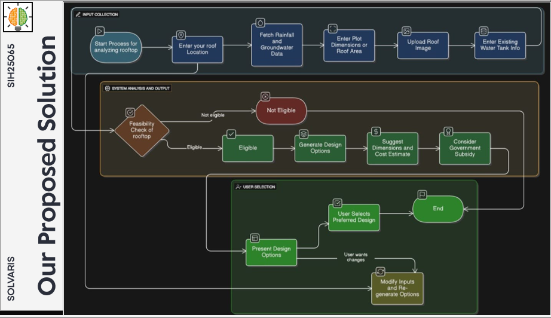

# SIH AI Workflow Visualization

This repository contains an AI-assisted workflow and system planning chart created for our Smart India Hackathon (SIH) software idea exploration.

The workflow was generated and refined using AI-powered visualization tools to better understand:
- feature flow,
- user interaction,
- system structure,
- and planning logic.

## Tools Used
- Eraser AI
- AI-assisted ideation workflows
- Prompt-based workflow generation

## Purpose
The goal of this exploration was to understand how AI tools can assist in software planning, workflow visualization, and structured brainstorming during the early stages of project development.

## Workflow Preview

